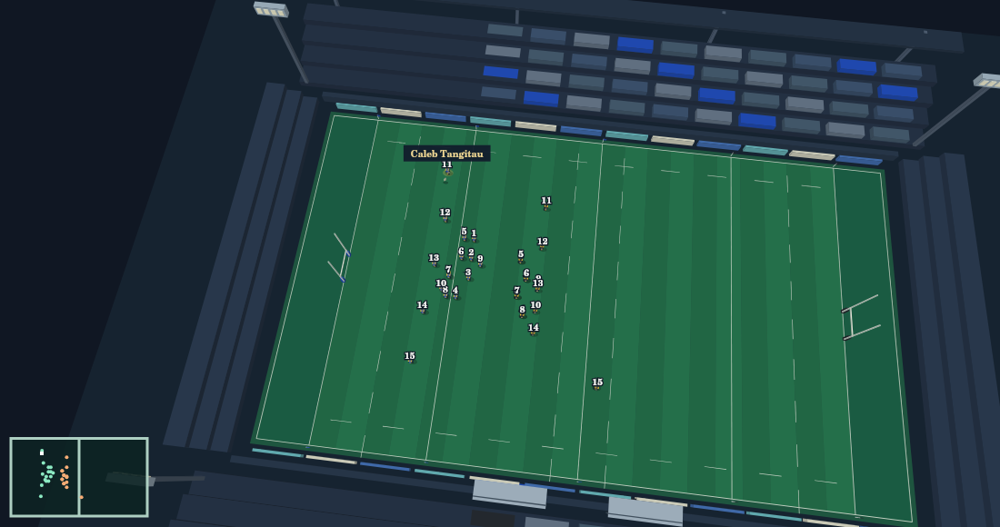
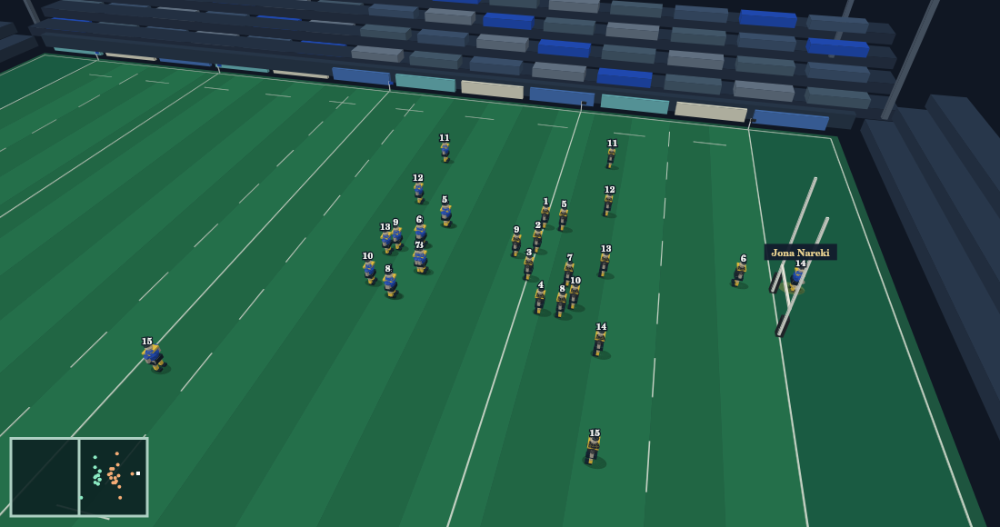

# Matchday 23: update report

The team sheet now carries the tactical job as well as the shirt. If the Highlanders replace their first distributor, the manager can hand the job over, use a rehearsed backup, simplify to carry first, or leave it uncovered. The same substitution rules run in a delegated match. New plans default to positional cover. Existing saved plans keep their previous behaviour until edited.

| Department | What changed in the game |
| --- | --- |
| Tactics and selection | Five jobs have cover plans. The selection view brings starting status, cover and medical minutes together. Receiving depth trades ground for passing safety; exit urgency changes when to kick in your own half; edge width trades inside space against outside protection. |
| Coaching and academy | Rehearse the starters or a named replacement group. Fixture preparation follows the exact combination; a smaller amount of learning stays with each player in that shape and job. A funded Set Piece Coach improves rehearsal. A funded Pathway Coordinator improves coaching exposure; a prospect still needs minutes at the agreed level. Both appointments cost cash and wages. |
| Staff and recruitment | Give the assistant a weekly coaching priority. If its first choice is unavailable it records why it used a fallback. Delegated scouting uses watchlist and performance evidence. The recruitment comparison shows internal options beside an external offer. |
| Inbox and board | The report shows opening assignments, handovers, throw outcomes, metres and breaks, and minutes against return limits. It can take you back to a missing assignment and remembers the selected report. Narrow screens switch between the list and message. Youth and playing-time targets now follow the club’s regular fixture count. |
| Match presentation | Named launches animate the distribution sequence. Director camera changes framing for set pieces, goals and open play. Updated player models and stadium, a shape map and a scrub control for the last watched highlight all read the same phase simulation. Positions illustrate the event; they are not measured tracking data. |

## Two frames from the game

Both images below were captured locally from the production software renderer. They use saved before/after phase states from a simulated Highlanders match (seed 173); neither is concept art. They show the pitch canvas, not the entire browser.

**1′:** Cameron Millar pulls the ball back to Timoci Tavatavanawai. Tanielu Tele’a holds the inside line; Caleb Tangitau receives out wide. Director selects the tactical view.

**28′:** Jona Nareki finishes. Director moves closer; the shape map still shows both teams.

## Did the decisions matter?

**Controlled halftime:** 20 fixtures across five clubs, each replayed from the same halftime state with five different cover instructions (100 finishes). Vacancy produced zero second-half named calls. Positional succession and naming the same incoming player each produced 82 calls across 18 fixtures. Explicit matchday overrides reproduced each corresponding outcome. For both teams in every finish, recorded throw dispositions added up to throws taken.

**Fijian Drua, six seeds:** 14 regular fixtures in each arm per seed. Fixed assigns the opening combination once and leaves jobs vacant; adaptive reassigns to the selected XV before each fixture and inherits on replacement. These are bundled policies; this test alone does not separate selection from substitution. Wins and margin are totals across 84 matches per arm.

| Policy | Wins | Points differential | Throws | Named calls | Lost on call | Throws blocked by missing first/runner |
| --- | ---: | ---: | ---: | ---: | ---: | ---: |
| Standard | 38 | -104 | 1124 | 0 | 0 | 0 |
| Fixed | 32 | +4 | 1149 | 448 | 22 | 457 |
| Adaptive | 39 | -63 | 1146 | 849 | 55 | 6 |

Across those six seeds, the adaptive policy won more fixtures than fixed in four, fewer in one and the same in one. On seed 271 it lost five wins despite eliminating all 102 missing-role throws. Across all seeds, recorded possession losses rose from 22/448 named calls (4.9%) to 55/849 (6.5%). Keeping a play available gave the manager more chances to use it, including chances to lose the ball.

**Three seasons:** five clubs, two policies, one starting seed per club. 427 managed fixtures including playoffs. Both arms refreshed their starting assignments before each match; only in-match succession differed. Where an eligible prospect existed the same selection and funded-coaching rules were used. Every throw reconciled and all 30 year-end saves passed validation.

| Club | Managed fixtures, vacant / inherit | Named calls, vacant / inherit | Throws blocked by missing first/runner, vacant / inherit |
| --- | ---: | ---: | ---: |
| Highlanders | 43 / 43 | 339 / 405 | 61 / 6 |
| Queensland Reds | 50 / 48 | 438 / 486 | 71 / 2 |
| Fijian Drua | 43 / 46 | 384 / 431 | 59 / 1 |
| Moana Pasifika | 42 / 42 | 351 / 397 | 79 / 3 |
| Otago | 34 / 36 | 251 / 307 | 90 / 2 |

The Queensland prospect logged 960 development minutes in year one, then zero senior or development minutes in years two and three in both arms. The Highlanders had no qualifying prospect under the study’s selection rule. Hiring or funding coaches cannot substitute for selection; the first case is a specific pathway failure to investigate, not evidence of a successful graduation.

The strongest result is tactical continuity. These runs do not establish real-world scoring balance or prove a particular staff appointment creates senior players. The career data includes sampled prospect senior/development minutes, funded sessions and cash. It does not track role-specific starts or missed promises; careers without a qualifying prospect are marked null.

**Verification:** TypeScript check, production build, 134 automated tests passed. Same-input phase, highlight and immediate modes produced identical match records under identical delegated decisions. Tests cover funded practice, save/load, substitution legality, vacancy overrides and deterministic 3D frames. Historical matches without the new ledger are marked unrecorded. Browser preview was blocked; full-page layout, mobile interaction, WebGL performance and account-backed end-to-end play were not verified in this run.

**Try it:** open Tactics → Named combinations, choose Two distributors, name first/runner/second and a bench successor, and save. Set the lineout exit to Launch. In Staff, rehearse the named cover. Use Extended highlights and Director camera, change the distributor at halftime, then open the inbox match review.

[Controlled match trials](matchday23-checks.json) · [Season and career results](matchday23-season-results.json). Reproduce with the scripts in this commit: `validate-matchday23.mjs`, `compare-matchday23-seeds.mjs`, `compare-matchday23-careers.mjs` and `capture-matchday23.mjs`.
